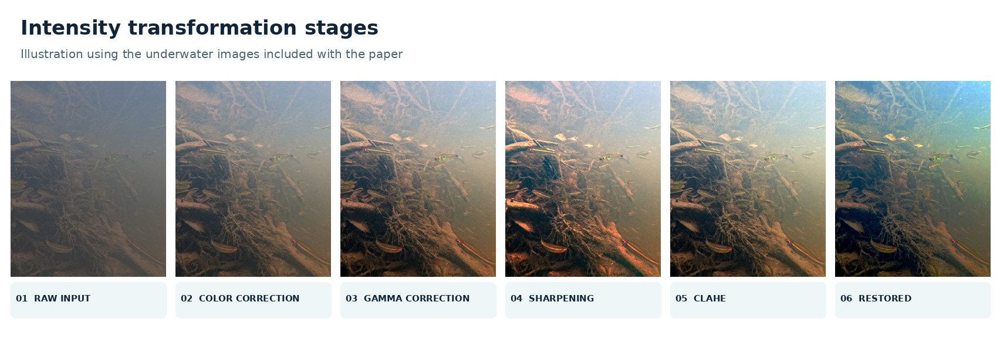
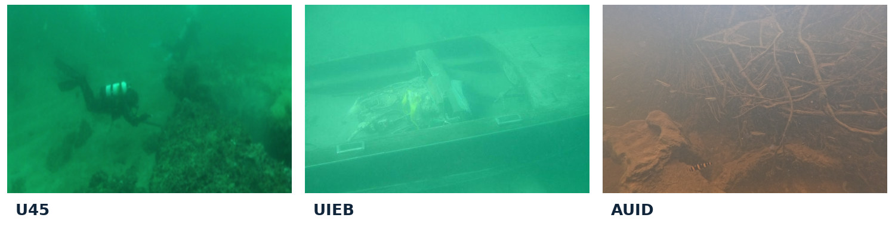
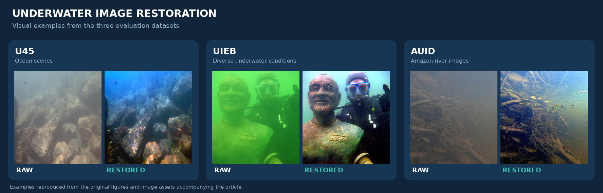

<!-- <div align="center"> -->

# 🌊 Diving into Clarity

### Restoring Underwater Images using Deep Learning

**CNN-based regression and intensity transformation fusion for underwater image restoration**

[](https://doi.org/10.1007/s10846-024-02065-8)
[](https://doi.org/10.1007/s10846-024-02065-8)


[](https://drive.google.com/drive/folders/1-fKpwApf9rQnS5iPR-Yew6ORYdWB1Lev?usp=sharing)


---
## About the Project

This is the **official repository** for the paper **“Diving into Clarity: Restoring Underwater Images using Deep Learning”**, published in the *Journal of Intelligent & Robotic Systems* (2024). The project addresses the challenge of **enhancing the quality of underwater images using deep learning**. Underwater imagery is affected by **water absorption, scattering, turbidity, low visibility, color distortion, and nonuniform illumination**. Our approach combines a **Convolutional Neural Network (CNN) regression model**, which learns the optimal enhancement parameters from underwater images, with **intensity transformation techniques** applied to the raw inputs.

Instead of using the same fixed parameters for every scene, the network learns image-specific values for **color correction, gamma correction, and image fusion**. The restoration process additionally employs contrast enhancement, histogram processing, unsharp masking, and brightness adjustment to recover underwater visual information.

The method was evaluated with two established ocean-image datasets (**U45** and **UIEB**) and **AUID**, a dataset introduced in this research containing **276 images acquired in the Urubu River, in the Amazon region of Brazil**.

---
The objective is to recover visibility and meaningful scene details while adapting the processing to the characteristics of each input image.


<div align="center">
  
  <br>
  <sub><b>Figure 2.</b> Illustration of processing stages using the original image assets from the paper.</sub>
</div>


### End-to-End Workflow

The two accompanying notebooks represent the main stages of the approach:

```text
 Underwater images (U45 / UIEB / other scenes)
                     │
                     ▼
      UIEFT_BEST_PARAMS.ipynb
  Search enhancement-parameter combinations
  Restore candidates and evaluate UCIQE / UIQM
  Store the selected parameters as image labels
                     │
                     ▼
      Labeled underwater image dataset
                     │
                     ▼
       UIEFT_REGRESSION.ipynb
  Train the CNN on images + parameter labels
  Predict [cci, gamma, alpha, beta] for new input
                     │
                     ▼
         Intensity transformation
         + fusion + final enhancement
                     │
                     ▼
            Restored underwater image
```
---

## Evaluation Datasets

The framework was assessed in diverse underwater conditions, from natural ocean scenes to highly turbid Amazon river water.

<div align="center">
  
  <br>
  <sub><b>Figure 4.</b> Representative images from the three evaluation datasets.</sub>
</div>

| Dataset | Images | Environment | Description |
| :--- | ---: | :--- | :--- |
| **U45** | **45** | Ocean | Underwater images containing varied natural visibility and color conditions. |
| **UIEB** | **890** | Ocean | Underwater image enhancement benchmark with varied real-world aquatic scenes. |
| **AUID** | **276** | Amazon river | Amazon Underwater Image Dataset, acquired in the Urubu River under challenging blackwater conditions. |

### 🌿 Amazon Underwater Image Dataset (AUID)

[](https://drive.google.com/drive/folders/1-fKpwApf9rQnS5iPR-Yew6ORYdWB1Lev?usp=sharing)

The **AUID dataset**, introduced with this research, represents an important contribution for studying restoration in **Amazon aquatic environments**. Its 276 underwater images were acquired in the **Urubu River**, a blackwater tributary of the Amazon River, and include conditions such as:

- High levels of suspended particles and turbidity;
- Scattering and severe visibility reduction;
- Low and uneven underwater lighting;
- Dark water coloration and reduced scene contrast.

These characteristics make AUID a challenging evaluation setting for underwater enhancement techniques.

> **Dataset availability:** The notebooks and documentation are included here. The underwater image datasets are provided separately; the **original AUID download** is linked above. To train the regressor, first prepare image files labeled with their enhancement parameters.

---

## 📁 Repository Structure

```text
Diving-into-Clarity/
│
├── UIEFT_BEST_PARAMS.ipynb     # Parameter search, restoration and label preparation
├── UIEFT_REGRESSION.ipynb      # CNN training, parameter prediction and evaluation
├── requirements.txt           # Python dependencies
├── README.md                  # Project documentation
├── .gitignore                 # Local datasets, environments and model outputs
│
└── assets/                    # Publication figures used in this README
    ├── restoration-gallery.jpg
    ├── methodology.png
    ├── restoration-stages.jpg
    ├── cnn-architecture.png
    ├── dataset-samples.jpg
    └── auid-benchmark.jpg
```

## Implementation Notebooks

The implementation is organized into **two complementary Jupyter notebooks**, following the workflow described in the paper.

### `UIEFT_BEST_PARAMS.ipynb` — Enhancement and Optimal Parameter Search

This notebook implements the image-restoration operations and searches candidate combinations of enhancement parameters for underwater images. It is used to create labeled examples for supervised CNN regression.

**Main components:**

- **Image restoration:** color correction, gamma correction, unsharp masking, CLAHE, image fusion, and brightness/contrast enhancement.
- **Parameter exploration:** combinations of `cci`, `gamma`, `alpha`, and `beta` are evaluated for each input image.
- **Image quality assessment:** candidate outputs are compared using **UCIQE** and **UIQM**.
- **Selection and export:** chosen parameter combinations are recorded in text files and encoded into output-image filenames for use as regression labels.
- **Dataset experiments:** sections for **U45**, **UIEB**, and additional underwater imagery.

**Key functions:** `UWE()`, `colorCorrection()`, `gammaCorrection()`, `mascaraNitidez()`, `CLAHE()`, `add()`, `enhacement()`, `getUCIQE()`, `getUIQM()`, and `maior_valor()`.

### `UIEFT_REGRESSION.ipynb` — CNN Parameter Estimation

This notebook implements the **CNN regression model** used to estimate image-specific restoration parameters. It trains on image/parameter pairs and uses the predictions to enhance previously unseen underwater images.

**Main components:**

- **Data loading:** reads labeled PNG images and extracts `cci`, `gamma`, `alpha`, and `beta` values from their filenames.
- **Preprocessing:** resizes inputs to `64 × 64 × 3`, splits training/testing data, and scales pixel values.
- **CNN training:** three convolutional blocks and two fully connected layers predict four continuous outputs.
- **Model selection:** includes 5-fold cross-validation and Grid Search experiments.
- **Image restoration:** passes predicted parameters to `UWE()` for underwater image enhancement.
- **Evaluation:** compares estimated parameters, displays qualitative outputs, and calculates **UCIQE** and **UIQM** for restored images.

**Key functions and routines:** `criar_modelo()`, `modelo.fit()`, `modelo.predict()`, `UWE()`, and the evaluation cells.

---

## Getting Started

The notebooks are organized for **Google Colab with Google Drive datasets**, which is the recommended way to execute the implementation. They can also be adapted for local Jupyter execution.

### 1. Requirements

- Python **3.10+**;
- Google Colab or Jupyter Notebook;
- **TensorFlow/Keras**, **OpenCV**, **NumPy**, **SciPy**, **Pillow**, **scikit-image**, **scikit-learn**, **Matplotlib**, and **pandas**;
- Access to underwater images for parameter search and to labeled images for regression training.

**Install locally:**

```bash
python -m venv .venv
```

Activate it on Linux/macOS:

```bash
source .venv/bin/activate
```

Or on Windows:

```powershell
.venv\Scripts\activate
```

Install the dependencies and start Jupyter:

```bash
pip install -r requirements.txt
jupyter notebook
```

In **Google Colab**, upload/open either notebook and install the packages if needed:

```python
%pip install numpy scipy pillow opencv-python-headless scikit-image scikit-learn matplotlib pandas tensorflow scikeras
```

> **Compatibility note:** In current TensorFlow/Keras installations, the scikit-learn wrapper can be imported from `scikeras` as `from scikeras.wrappers import KerasRegressor`. When running the Grid Search cells in `UIEFT_REGRESSION.ipynb`, use this import instead of the legacy `tensorflow.keras.wrappers.scikit_learn` import, and initialize it with `KerasRegressor(model=criar_modelo)`. The standard CNN training section can be run independently of Grid Search.

### 2. Connect Google Drive

Open the first notebook, `UIEFT_BEST_PARAMS.ipynb`, in [Google Colab](https://colab.research.google.com/) (**File → Upload notebook**), then mount your Drive in a cell near the beginning:

```python
from google.colab import drive
drive.mount('/content/drive')
```

Choose **Runtime → Change runtime type → GPU** when training the CNN, if GPU acceleration is available.

### 3. Run `UIEFT_BEST_PARAMS.ipynb` — Find Enhancement Parameters

1. Execute the imports and the **Pipeline**, **Main**, and **Evaluation** cells to define the restoration and metric functions.
2. Run the **Best results func** cells that define `maior_valor()` and related helpers.
3. Select the dataset experiment to run (**U45**, **UIEB**, or another image directory).
4. Set the input directory (`DIR`), the output-image directory (`DIR_results`), and the text-results path (`arquivo`) in the chosen experiment cell.
5. Make sure these directories exist, then execute the selected experiment cell.

**Example — U45 paths already used in the notebook:**

```python
DIR = '/content/drive/MyDrive/UWE/Data/U45_DATASET/U45 Dataset/U45/U45/'
DIR_results = '/content/drive/MyDrive/UWE/Data/U45_DATASET/U_45_results/'
arquivo = '/content/drive/MyDrive/UWE/Data/U45_DATASET/u45_results.txt'

import os
os.makedirs(DIR_results, exist_ok=True)
```

The notebook examines combinations of color correction, gamma, and fusion weights. It **exports the selected input images under parameter-encoded filenames**, and records the corresponding parameter/quality-metric values in a text file.

**Example of a regression-ready filename:**

```text
image01_8_9_4_5_...png
        │ │ │ │
        │ │ │ └── beta  = 0.5
        │ │ └──── alpha = 0.4
        │ └────── gamma = 0.9
        └──────── cci   = 0.8
```

The first four numeric fields after the image identifier are the target labels. **Values are stored multiplied by 10** (for example, `0.8` is represented as `8`). Avoid underscores inside the *original image identifier*, since the regression data loader expects those four labels immediately after its first underscore.

### 4. Prepare the CNN Training Dataset

Place the generated, parameter-labeled **PNG files** into the folder read by `UIEFT_REGRESSION.ipynb`:

```text
MyDrive/
└── UWE/
    └── UIEFT_Regression/
        └── Dataset/
            ├── image01_8_9_4_5_...png
            ├── image02_9_8_5_6_...png
            └── ...
```

For example, copy the outputs from the U45 parameter-search experiment:

```python
from pathlib import Path
from shutil import copy2

source = Path('/content/drive/MyDrive/UWE/Data/U45_DATASET/U_45_results/')
target = Path('/content/drive/MyDrive/UWE/UIEFT_Regression/Dataset/')
target.mkdir(parents=True, exist_ok=True)

for image_file in source.glob('*.png'):
    copy2(image_file, target / image_file.name)
```

The data-loading code in the regression notebook reads this folder using the variable `caminho_pasta`. Update that path if you organize the dataset differently.

### 5. Run `UIEFT_REGRESSION.ipynb` — Train the CNN

1. Open `UIEFT_REGRESSION.ipynb` in Google Colab and mount Google Drive.
2. Run the image-processing functions and the quality-metric definitions at the beginning of the notebook.
3. Run the imports, adjusting the `KerasRegressor` import as indicated above if using a recent environment.
4. Run the **image/label loading**, **train/test split**, and **CNN architecture** sections. Before running the standalone summary cell, initialize the CNN with `modelo = criar_modelo()` (or skip that summary cell).
5. Run the **“Versão testada com o melhor resultado”** training cell to train and evaluate the model, then run the **prediction** and **evaluation** cells.
6. Optionally, explore the **5-fold validation and Grid Search** section to compare candidate configurations. To run the optional MSE and R² reporting cell, import `mean_squared_error` and `r2_score` from `sklearn.metrics` first.

**CNN input and output:**

```text
Input image (64 × 64 × 3)
            │
       CNN regressor
            │
[cci, gamma, alpha, beta]
            │
  Intensity transformation
    + image fusion (UWE)
            │
    Enhanced RGB image
```

The implementation uses **four regression labels** (`cci`, `gamma`, `alpha`, `beta`). The estimated label values are rescaled by dividing by `10` before being supplied to the restoration function.

**Training configuration presented in the article:**

```python
modelo.fit(
    X_treinamento,
    y_treinamento,
    epochs=50,
    batch_size=128,
    verbose=1
)
```

This training call may be used in place of the shorter demonstration training call in the notebook when running the published experimental configuration.

### 6. Predict Parameters and Restore an Image

In the `UIEFT_REGRESSION.ipynb` section **“Teste para predizer valores dos parametros para uma imagem qualquer”**, set `DIR_IMG` to your input image and execute the prediction cell after training:

```python
DIR_IMG = '/content/drive/MyDrive/UWE/Data/Caru_Dataset/GOPR0441.JPG'
```

The notebook resizes the image for CNN inference, predicts the four parameters, and restores the **original-resolution input** using `UWE()`. To save the result, run the following cell after the restoration cell:

```python
import cv2
cv2.imwrite('/content/drive/MyDrive/UWE/restored_example.png', restored)
```

The test-set evaluation section also provides before/after visualization, predicted-versus-target parameters, and batch metric reporting.

### Running Locally (Jupyter)

Start Jupyter after installing `requirements.txt`, open **`UIEFT_BEST_PARAMS.ipynb`** or **`UIEFT_REGRESSION.ipynb`**, and replace `/content/drive/MyDrive/...` with valid local paths. Colab-only imports such as `google.colab.patches.cv2_imshow` can be replaced with a local notebook display function:

```python
from IPython.display import display
from PIL import Image
import cv2

def show_bgr(image):
    display(Image.fromarray(cv2.cvtColor(image, cv2.COLOR_BGR2RGB)))

# show_bgr(restored)
```

### Input and Output Summary

| Stage | Input | Output |
| :--- | :--- | :--- |
| **Parameter search** | Underwater images + candidate enhancement ranges | Selected parameters, UCIQE/UIQM records, labeled PNGs |
| **CNN training** | Parameter-labeled underwater images | Trained regression CNN |
| **Image restoration** | New underwater image + predicted parameters | Enhanced underwater image |
| **Evaluation** | Restored images (and references when applicable) | Quality metrics and qualitative comparisons |

---

## Restoration Examples

<div align="center">
  
  <br>
  <sub><b>Figure 5.</b> Raw/restored underwater scenes from the published experiments, using the article's original image assets.</sub>
</div>

---

## Technologies

| Technology | Use |
| :--- | :--- |
| **Python** | Model and restoration implementation. |
| **TensorFlow / Keras** | CNN regression model and training. |
| **OpenCV** | Color correction, filtering, contrast enhancement, and image fusion. |
| **NumPy / SciPy** | Numerical operations and image manipulation. |
| **Pillow** | Image reading and resizing. |
| **scikit-image** | Image-quality measurement and processing utilities. |
| **scikit-learn / SciKeras** | Train/test splitting, cross-validation, and parameter search. |
| **Matplotlib** | Training-history plots and visual inspection. |
| **pandas** | Aggregate and export image-quality results. |
| **Google Colab / Jupyter** | Notebook-based training and experimentation. |

---

## Applications

The restoration framework is relevant to underwater computer vision and robotics research, including:

- **Underwater robotics and navigation** — clearer visual input for autonomous or remotely operated systems.
- **Inspection and monitoring** — improved visibility in low-contrast aquatic scenes.
- **Marine and river ecology** — support for visual observation of underwater habitats and organisms.
- **Search and rescue** — enhancement of imagery acquired under adverse underwater visibility.
- **Image enhancement research** — evaluation of adaptive parameter estimation and hybrid restoration pipelines.

---

## 📚 Citation

If you use this implementation, the proposed method, or the AUID dataset in academic work, please cite:

```bibtex
@article{Martinho2024,
  author  = {Martinho, Laura A. and Cavalcanti, Jo{\~a}o M. B. and Pio, Jos{\'e} L. S. and Oliveira, Felipe G.},
  title   = {Diving into Clarity: Restoring Underwater Images using Deep Learning},
  journal = {Journal of Intelligent \& Robotic Systems},
  volume  = {110},
  number  = {32},
  year    = {2024},
  doi     = {10.1007/s10846-024-02065-8},
  url     = {https://doi.org/10.1007/s10846-024-02065-8}
}
```

**Paper:** [*Diving into Clarity: Restoring Underwater Images using Deep Learning*](https://doi.org/10.1007/s10846-024-02065-8) — *Journal of Intelligent & Robotic Systems* (2024).

